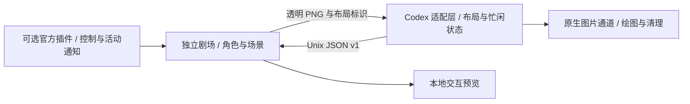

# 输入框旁的小伙伴剧场

让 17 位模型拟人角色在 Codex CLI 输入框附近散步、聊天、分享饼干和追逐纸团。默认四位登场，其他角色轮换来访；输入时收敛动作，菜单和审批框出现时退让。**角色下方的名字默认隐藏**，网页预览可用“显示名字”按需开启。


[查看实际引擎导出的动画](artifacts/theater-demo.webp)

每人 16 个姿势，共 272 帧透明素材。场景包括散步、聊天、分饼干、纸团打闹、茶会、巡游和完成庆祝。文心保持轮椅移动，RWKV 保留鸟翼和鸟足。对白是本地情景脚本，不调用各家模型 API；输入内容、历史对话和工具内容不传给剧场。

## 先看预览

目前面向 Linux 桌面环境，要求 Python 3.12+、Pillow 和 Noto CJK 字体。源码目录运行即可；无需先构建 Codex。

```sh
git clone https://github.com/Maverick-Ace/codex-companion-theater.git
cd codex-companion-theater
python3 -m venv .venv
. .venv/bin/activate
python -m pip install -e .
python scripts/codex-theater --preview
```

打开终端打印的本地地址，选择角色、人数和场景。预览与 CLI 共用同一动作引擎。名字开关仅控制舞台中的标签，角色选择面板保留名称以便辨认。Ubuntu/Debian 缺少中文字体时可安装 `fonts-noto-cjk`；ImageMagick 仅在重新切帧时需要。

## 接入 Codex CLI

当前经过验证的版本为 **Codex 0.163.0**，Rust 工具链为 **1.94.1**，主要显示环境为 **Ghostty / Kitty graphics**。构建器从官方 tag 导出干净源码，保留原仓库和系统安装。

```sh
git clone --depth 1 --branch rust-v0.163.0 https://github.com/openai/codex.git ../codex-source
rustup toolchain install 1.94.1
python scripts/build_cli.py --source ../codex-source --check
python scripts/build_cli.py --source ../codex-source
./scripts/codex-theater
```

构建不会运行 Rust 格式化命令。首次构建会下载依赖，耗时和磁盘需求与 Codex 本身相近。可通过 `CARGO_HOME`、`CARGO_TARGET_DIR` 和 `CARGO_BUILD_JOBS` 复用缓存、调整构建并行度。二进制存于 `build/bin/`；系统的 `codex` 不会被替换。

需要独立命令时，可在仓库根目录执行：

```sh
mkdir -p ~/.local/bin
ln -s "$PWD/scripts/codex-theater" ~/.local/bin/codex-theater
codex-theater
```

入口透传原 CLI 参数，例如 `codex-theater resume <会话ID>`。它临时关闭原生单宠物显示，启动专属引擎和 socket，退出时清理；不写全局宠物设置。Codex 自身的文件夹信任、审批和权限机制照常生效。

## 控制角色与场景

在由剧场启动器开启的 Codex 工具环境中，`CODEX_THEATER_SOCKET` 已指向当前实例：

```sh
python -m theater.cli status
python -m theater.cli cast gpt deepseek seed claude
python -m theater.cli scene paperball
python -m theater.cli density 3
python -m theater.cli quiet
python -m theater.cli play
python -m theater.cli pause
python -m theater.cli resume
```

场景 ID 为 `roam`、`chat`、`cookie`、`paperball`、`tea`、`parade`、`celebrate`。另一个独立终端需要通过 `--socket <路径>` 指定实例，不按工作目录猜测其他会话。

## 插件与适配边界

官方插件适合分发技能、MCP 控制工具和活动 hooks，目前没有 CLI 的逐帧绘图或输入框几何接口。因此采用 **插件控制 + 独立引擎 + 薄 TUI 适配层**。插件能力边界已按 [官方插件说明](https://developers.openai.com/plugins/concepts/plugins) 和 [0.163.0 资源类型](https://github.com/openai/codex/blob/83086188ae0614bd882818ff1aa23f3194962012/codex-rs/plugin/src/manifest.rs) 核对。



适配仅修改三个现有 Rust 文件，新增一个桥接模块。角色、对白和引擎更新通常无需重编译 Codex。后台 IPC 使用有界队列，旧布局和失联帧隐藏；原生通道负责光标恢复和退出清图。迁移工具对已验证版本自动检查、隔离构建，遇到未知版本或不匹配接入点会停止。

`plugin/` 包含标准清单、五个 MCP 工具、操作技能和可选 hooks；一个小型 Codex overlay 仅转发当前实例的 socket 环境变量。插件已在隔离的临时 `CODEX_HOME` 中完成安装和 MCP 配置回读测试。用户可按需安装：

```sh
# 在本仓库根目录执行
codex plugin marketplace add "$PWD"
codex plugin add companion-theater@companion-local
```

hooks 需在 `/hooks` 中单独查看并信任。未启用 hooks 时，自由活动、原生忙闲跟随及命令控制仍然可用。插件本身不能为未经适配的原版 CLI 增加内嵌绘图能力。

## 素材与扩展

角色目录 `assets/cast/<id>/` 包含提示词、原始生成 sheet 和 16 张提取帧，来源和作者见 [素材署名](assets/CREDITS.md) 与 `assets/cast/catalog.json`。Q 版动作图使用内置 image_gen 生成，ImageMagick 负责确定性切帧和基线对齐。原始参考立绘不随仓库分发；不同原设的许可分别记录，未被宣称为统一开源许可。

对白存于 `config/scenes.json`。替换角色图或修改对白后重启引擎即可，无需改 Codex 源码。重新提取素材可运行 `python scripts/prepare_sprites.py`；已有提取帧会保留。

## 验证与当前限制

```sh
python -m unittest discover -s tests -v
python scripts/doctor.py
python scripts/verify_native.py --cwd /path/to/already-trusted-folder
python scripts/verify_native.py --cwd /path/to/already-trusted-folder --disconnect
```

已通过 12 项行为/协议测试、12 项原生图片发送/清理测试、2 项官方插件环境转发测试。真实 CLI 的 PTY 检查覆盖出帧、输入、菜单、缩放、正常退出及引擎失联，不提交模型请求。PTY 证明输出协议与生命周期行为，最终视觉效果仍以实际终端体验为准。

当前只有 0.163.0 的迁移配置经过验证。Sixel、Windows、tmux 和 Zellij 尚未完成本项目的实际显示验证，可先使用网页预览。
